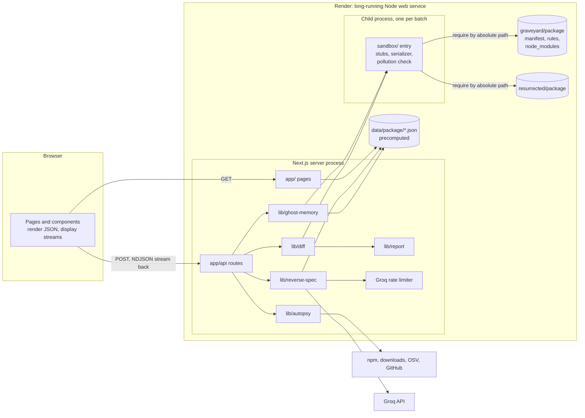

# Design Document

## Overview

Revenant is a Next.js (App Router) web service that runs on Render as a long-running Node process. It walks a visitor through five stages for each package in a small curated Graveyard: Autopsy, Ghost Memory, Reverse Spec, Resurrection (done in Kiro, not in the app), and the Rebirth Report. It reports evidence that a rebuild behaves like the original. It does not claim proof of equivalence.

This design follows `DESIGN-NOTES.md`. Sections 1 to 5 of the notes are implemented as written. Section 6 holds verified facts, checked on 2026-11-17, and is carried in below as facts. Section 7 (coverage) is resolved here as Option A.

### Design decisions at a glance

| Decision | Choice | Rationale |
|---|---|---|
| Evidence grouping before the LLM | Deterministic behavior classes from manifest-defined features (notes section 1) | Groq never sees the full recording, and citations point to classes that resolve to Evidence_IDs |
| Evidence ID | `<package>:<export>:<first 12 hex of sha256(canonical serialized input)>` (notes section 2) | The same input gives the same ID across runs |
| Sandbox file access | Read only `sandbox/` output and the package directory under test (notes section 3) | Least privilege |
| Network isolation | Mandatory JavaScript-level stubs on top of the permission model | The permission model does not block network on Node 22 (verified 2026-11-17) |
| Intentional differences | Rules in `graveyard/<package>/intentional-differences.json` (notes section 4) | Unexplained differences stay mismatches |
| Page rendering | Precomputed JSON first, "Run live" second (notes section 5) | Fast first paint after a Render cold start; cached data is always labelled |
| Coverage | **Option A**: offline coverage pass for curated packages | See "Coverage decision" below |
| Where generators run | In the parent process; inputs are serialized and sent to the child | See "Where generated inputs come from" |
| Archive format for the spec bundle | Minimal built-in store-only ZIP writer | No extra dependency |

### Verified facts carried in from DESIGN-NOTES section 6 (checked 2026-11-17)

- On Node v22.23.1, `--permission` works (alias `--experimental-permission`). The grant flags are `--allow-fs-read=<path>`, `--allow-fs-write=<path>`, `--allow-child-process`, `--allow-worker`, `--allow-addons`, `--allow-wasi`. With `--permission` and only `--allow-fs-read`, fs writes and `child_process` fail with `ERR_ACCESS_DENIED`.
- The permission model does **not** block network on Node 22. `fetch` to an external URL succeeded under `--permission`.
- V8 coverage does not work inside the permission-model sandbox. `NODE_V8_COVERAGE` writes no files, and `inspector.Session.connect()` throws `ERR_ACCESS_DENIED`.
- Graveyard data (live registry, downloads and OSV with a version query):

| Package@version | Last publish | npm deprecated | Weekly downloads | OSV vulns affecting this version |
|---|---|---|---|---|
| lodash.set@4.3.2 | 2016-08-13 | no | ~2.0M | GHSA-p6mc-m468-83gw (CVE-2020-8203) |
| lodash.pick@4.4.0 | 2016-08-13 | yes ("Use destructuring assignment syntax instead.") | ~2.2M | GHSA-p6mc-m468-83gw (CVE-2020-8203) |
| string@3.3.3 | 2016-10-11 | no | ~80K | GHSA-g36h-6r4f-3mqp (CVE-2017-16116, ReDoS) |
| deep-extend@0.6.0 | 2018-05-22 | no | ~60M | none (CVE-2018-3750 exists but does not affect 0.6.0) |

All four are MIT. Download counts change weekly, so the app shows live values and labels stored ones with their timestamp.

- **Monorepo caveat:** `lodash.set` and `lodash.pick` point to `github.com/lodash/lodash`, which is not archived and was pushed to recently. The Death Certificate labels this as "source repo is the lodash monorepo" and bases "dead" on last publish date.
- **ReDoS caveat:** `string@3.3.3` has a known ReDoS issue, so some generated inputs may hit the per-call timeout. Timeouts are recorded as Evidence, not treated as crashes.

### Items not yet verified

Everything not listed above is unverified. Such items carry the literal word "verify" in this document. The consolidated list is in "Known Risks and Open Items".

## Architecture



### Boundaries

- **Browser to server.** The browser renders JSON and displays streamed progress. It never executes tests or package code (Req 7.6). Long operations return an NDJSON stream (`application/x-ndjson`) from a Route Handler using a web `ReadableStream`. Whether Render's proxy buffers the stream is unproven, so verify with a deployed streaming route before relying on it.
- **Server to sandbox.** The Next.js process never loads package code. Each batch runs in a separate Node child process started with the permission model. `sandbox/` imports nothing from `app/`, and does not import `lib/` either, so it can be compiled and run on its own.
- **Server-only code.** `lib/` and `sandbox/` are never imported from client components. A test scans client files for such imports (Req 5.9).
- **Precomputed first.** Pages render from `data/<package>/*.json`. "Run live" buttons trigger a real Autopsy fetch or a real sandboxed run. Precomputed data always shows its generation timestamp so it is never presented as live.

### Process model and build output

- `sandbox/` and the CLI in `lib/diff/cli.ts` are plain Node programs. They are compiled with `tsc` (already in the stack) into `sandbox/dist/` and `lib/diff/dist/` at build time. The server starts the child with `process.execPath` and an absolute path to `sandbox/dist/child.js`, resolved at runtime so the Next.js bundler does not trace or bundle it. Verify that `next build` leaves these paths untouched on Render.
- The child is started with an empty environment (`env: {}` plus nothing else), so `GROQ_API_KEY` and `GITHUB_TOKEN` are not reachable from package code.

### Graveyard packages are subjects under test, not app dependencies

The four Graveyard packages are installed at build time into a separate package root, `graveyard/package.json`, with `npm ci --ignore-scripts` run in that directory. They are never listed in the root `package.json`. No file under `app/`, `lib/` or `components/` may import them. An ESLint `no-restricted-imports` rule and a Vitest test that greps import specifiers enforce this. Only the sandbox child loads them, by absolute path, for example `graveyard/node_modules/lodash.set/`.

This differs slightly from DESIGN-NOTES section 3, which says `node_modules/<package>/`. The read grant is `graveyard/node_modules/<package>/` instead, for the reason above. The permission is otherwise as the notes state.

### Where generated inputs come from

**Choice: generators run in the parent process. The parent serializes each input with the tagged serializer and sends it to the child.** Alternative considered: run fast-check inside the child.

- Why parent: fast-check and generator code stay out of the sandbox (smaller read grant, no generator code running next to untrusted code). The same serialized inputs go to both the original and the rebuild, which makes "same seed and generators" literally the same input list rather than two runs that need to agree. The seed reproduction question reduces to one process running one generator version.
- Cost: every input crosses the process boundary, so inputs are limited to what the serializer can express (primitives, plain objects, arrays, tagged values, circular references). Inputs that contain live functions cannot be sent. Generators for the four packages are limited to the serializable domain. Verify per package that this domain is enough for the exports under test.
- The child deserializes a fresh copy of the input for every call, so mutation of arguments is observed on that copy and sent back as the post-call state.
- Whether a given fast-check seed yields the same sequence across Node and fast-check versions is unproven. The recording stores the generated, serialized inputs (or their hashes plus the seed) so a recording remains usable if the generator changes. Verify seed reproducibility on the pinned versions.

### Coverage decision (DESIGN-NOTES section 7): Option A chosen

Option A: a separate offline coverage pass for curated packages only. A developer or the build runs it without `--permission` (network stubs still on). It replays the stored recording's inputs in a child started with `NODE_V8_COVERAGE`, then a small summarizer in `lib/ghost-memory/coverage.ts` reduces the V8 JSON to two numbers: exported functions exercised (computed from the Evidence, not from V8) and branch coverage (share of V8 block ranges with count above zero for the package files). The result is stored in `data/<package>/coverage.json` with its timestamp. The UI labels it "coverage from the stored recording, measured offline on <timestamp>". Live sandboxed runs do not report coverage.

Option B (instrument pinned source at build time with something like istanbul-lib-instrument and return counters over IPC) was rejected for the MVP because it adds a runtime or build dependency, adds a build step, changes the code under test (instrumented source is not the published source), and gains only live coverage numbers that the stored recording already provides for a fixed Graveyard.

Consequence for Req 3.3: coverage is displayed from the stored recording, not computed on live runs. Whether the V8 pass works for each package is unproven, so verify per package. If it fails for a package, the UI shows "coverage unavailable" for it and the exported-functions figure only.

## Requirements Traceability

| Req | Components | Main mechanism |
|---|---|---|
| 1. Graveyard curation | `graveyard/*/manifest.json`, `graveyard/package.json`, `lib/graveyard/` (loader, allowlist, pin check), build script | Allowlist loader refuses unknown names; build step runs `npm ci --ignore-scripts` and an exact-pin validator that fails the build |
| 2. Autopsy and Death Certificate | `lib/autopsy/` (one module per API: npm, downloads, osv, github; `certificate.ts`), `app/api/autopsy`, `components/DeathCertificate` | Timeout-wrapped clients return value or "unknown"; certificate assembly is pure; GitHub responses cached |
| 3. Ghost Memory | `lib/ghost-memory/` (generators, recorder, evidence-id, classes, coverage), `data/<package>/ghost-memory.json`, `coverage.json` | fast-check in the parent feeds the sandbox; Evidence stored as JSON with seed and N; offline coverage per Option A |
| 4. Sandbox isolation | `sandbox/` (child, serializer, stubs, pollution), `lib/ghost-memory/sandbox-runner.ts` | Child per batch with permission model, limits, network stubs, tagged serialization, prototype snapshot compare, kill and respawn |
| 5. Reverse Spec | `lib/reverse-spec/` (groq client, prompt builder, citation check, bundle assembler), `data/<package>/reverse-spec.json` | Classes in, JSON requirements out, citations resolved by code, unsupported claims flagged, cached bundle fallback |
| 6. Groq limits and budget | `lib/reverse-spec/rate-limit.ts`, `components/GroqBudget` | In-memory counters: 5 per IP and 50 total per day, remaining budget returned to the UI |
| 7. Differential testing | `lib/diff/` (runner, comparator, scoring, stream), `app/api/diff`, `resurrected/lodash.set`, `resurrected/lodash.pick` | One input list sent to original and rebuild children; comparator; 60 s budget with partial results; NDJSON stream |
| 8. Intentional differences | `graveyard/<package>/intentional-differences.json`, `lib/diff/rules.ts` | Rule predicates over the pair of results; matched cases excluded from the score and counted per rule |
| 9. Rebirth Report | `lib/report/` (assembly, formatting, language guard), `components/RebirthReport` | Report built from a run result; "M / S inputs matched"; forbidden-word guard |
| 10. Spec bundle download | `lib/reverse-spec/bundle.ts`, `lib/reverse-spec/zip.ts`, `app/api/spec-bundle/[package]` | Bundle read from `data/<package>/reverse-spec.json`, packed by a built-in ZIP writer |
| 11. Halloween UI | `app/`, `components/`, `app/globals.css`, `lib/report/contrast.ts` (tokens) | Tailwind theme tokens, reduced-motion media query, contrast test on token pairs, no auth |
| 12. Manifest | `graveyard/<package>/manifest.json`, `lib/graveyard/manifest-schema.ts` | Schema validation including edge-case rule and N default of 1000 |
| 13. Resurrection CLI and hook | `lib/diff/cli.ts`, npm script `resurrect`, `.kiro/hooks/` | CLI exits non-zero on unexplained mismatches; one PostFileSave hook per resurrected package (`resurrect-lodash-set`, `resurrect-lodash-pick`) runs `npm run resurrect -- <package>` |

## Dependencies

tech.md allows Next.js, React, TypeScript, Tailwind CSS, `groq-sdk`, `fast-check`, Vitest, and Node 22. Everything else needs a stated reason.

| Item | Why needed | Alternative considered | Decision |
|---|---|---|---|
| Deep equality | Compare return values and mutated args | `node:util` `isDeepStrictEqual`; lodash `isEqual` | Use `node:util`. It treats `NaN` as equal to `NaN` and distinguishes `-0` from `0`, and it handles cycles. No dependency |
| Hashing for Evidence IDs | sha256 of canonical input | `node:crypto` | Use `node:crypto`. No dependency |
| Canonical JSON | Stable bytes for hashing | A small function that sorts keys over the tagged form | Write it (about 30 lines) in `lib/ghost-memory/evidence-id.ts`. No dependency |
| Streaming progress | Send progress and results to the browser | `ReadableStream` with NDJSON; SSE; WebSocket library | NDJSON over `fetch` with built-in `ReadableStream`. No dependency |
| Rate limiting | 5 per IP per day, 50 total | In-memory `Map`; Redis; a rate-limit package | In-memory `Map`. No dependency. Counters reset on restart (verify whether that is acceptable, or persist to a JSON file on disk) |
| Schema validation | Manifest, rules, recordings | zod; hand-written validators | Hand-written validators in `lib/graveyard/`, because the schemas are small and fixed. No dependency. Revisit if validators grow (verify) |
| Zip archive for the spec bundle | "Download Kiro spec bundle" | `archiver`, `jszip`, `tar` package, or a minimal writer | Write a store-only (no compression) ZIP writer, about 60 lines in `lib/reverse-spec/zip.ts`, using `zlib.crc32` from Node (`zlib.crc32` exists on Node v22.23.1, verified 2026-11-17 by the user, so no CRC table is needed). A small test reader checks the output. No dependency |
| TypeScript execution for scripts | Run CLI and offline scripts | Compile with `tsc` to `dist/`; Node native type stripping; `tsx` | Compile with `tsc` to `dist/`. No runtime dependency. Verify whether Node's native type stripping on the pinned version is simpler |
| V8 coverage summarizer | Option A coverage numbers | `c8`; own summarizer | Own summarizer over V8 JSON, offline only. No runtime dependency |
| Markdown rendering for specs in the UI | Show generated spec text | `react-markdown`; render as preformatted text | Preformatted text for the MVP. No dependency |
| Fonts and icons | Halloween theme | `next/font` (part of Next.js); icon libraries | `next/font` and inline SVG. No dependency |
| Graveyard packages | Subjects under test | n/a | Build-time installed in `graveyard/package.json`, pinned exactly, `--ignore-scripts`. Not app dependencies and never imported by app code (see Architecture) |

Result: no runtime dependency is added beyond tech.md. Dev-time tools beyond Vitest are limited to ESLint (already part of the Next.js template, verify) and `tsc`.

## Components and Interfaces

### Module layout (follows structure.md)

```
graveyard/
  package.json                  exact pins, installed with --ignore-scripts
  <package>/manifest.json
  <package>/intentional-differences.json
  <package>/original-tests/     only if available (see per-package notes)
lib/graveyard/                  loader, allowlist, manifest schema, pin check
lib/autopsy/                    npm.ts, downloads.ts, osv.ts, github.ts, certificate.ts, http.ts
lib/ghost-memory/               generators/, recorder.ts, evidence-id.ts, classes.ts, features/, sandbox-runner.ts, coverage.ts
lib/reverse-spec/               groq-client.ts, prompt.ts, citations.ts, bundle.ts, zip.ts, rate-limit.ts
lib/diff/                       runner.ts, comparator.ts, rules.ts, scoring.ts, stream.ts, cli.ts
lib/report/                     assemble.ts, format.ts, language-guard.ts, contrast.ts
sandbox/                        child.ts, protocol.ts, serialize.ts, stubs.ts, pollution.ts
app/api/                        autopsy, ghost-memory, reverse-spec, diff, spec-bundle
components/                     Graveyard, DeathCertificate, SeanceProgress, EvidenceTable, SpecView, RebirthReport, GroqBudget
data/<package>/                 autopsy.json, ghost-memory.json, classes.json, coverage.json, reverse-spec.json, diff-run.json
tests/
```

`lib/autopsy/http.ts` holds only the shared timeout wrapper. Each external API has its own module, and no `fetch` appears in UI code.

### Sandbox (`sandbox/`)

#### Process and limits

One child process runs one batch of inputs. The parent (`lib/ghost-memory/sandbox-runner.ts`) starts it with:

```
node --permission
     --allow-fs-read=<repo>/sandbox/dist
     --allow-fs-read=<repo>/graveyard/node_modules/<package>      (original)
     --allow-fs-read=<repo>/resurrected/<package>                  (rebuild runs)
     --max-old-space-size=<MB>
     sandbox/dist/child.js
```

No `--allow-fs-write`, `--allow-child-process`, `--allow-worker`, `--allow-addons` or `--allow-wasi`. Flag names are verified for Node v22.23.1 (notes section 6). Verified on Node v22.23.1 (2026-11-17, by the user): the package loads with only the two read grants (`sandbox/dist` and the package directory under test), with no extra read access needed. Not verified: whether Render's Node version matches v22.23.1. Verify by running the sandbox test suite on Render with the pinned version. `--experimental-permission` is the fallback spelling for older Node.

| Limit | Proposed value | Status |
|---|---|---|
| Per-call timeout | 1,000 ms | verify: pick after measuring the four packages |
| Per-run wall clock (live Ghost Memory) | 30 s | verify |
| Per-run wall clock (live differential, N=1000) | 60 s (Req 7.7) | The 60 s figure is from the requirements; whether N=1000 completes on Render hardware is unproven, verify |
| `--max-old-space-size` | 256 MB | verify against Render instance memory |
| Max serialized input size | 64 KiB | verify |
| Max serialized output size | 256 KiB; larger outputs recorded as an "output-too-large" error with the size | verify |

Whether Render allows these flags and per-process memory caps is unproven. verify.

#### Network stubs (mandatory, JavaScript-level)

Before the package is loaded, `sandbox/stubs.ts` replaces `http`, `https`, `net`, `dgram`, `tls`, `dns` (and their `node:`-prefixed and `dns/promises` forms) and `globalThis.fetch`. Each stub throws an `Error` named `NetworkBlockedError` whose message names the module. The stub is applied through a `Module._load` wrapper so `require('node:http')` returns the stub, and by overwriting the global properties.

The permission model does not block network on Node 22 (verified 2026-11-17: `fetch` succeeded under `--permission`), so these stubs are the only network control inside the child. **They are a JavaScript-level defense, not OS isolation.** Package code that reaches Node internals by another route (for example `process.binding`, or a handle obtained before the stubs run) could still open a socket. The main safeguard is that only the curated, pinned Graveyard packages are ever run. The stubs and the empty child environment limit damage if a curated package misbehaves. They are not a barrier to hostile code, and the design does not claim they are. For this reason user-supplied packages stay out of scope.

#### Prototype pollution check

At child start, after stubs and before loading the package, `sandbox/pollution.ts` takes a snapshot for `Object.prototype`, `Array.prototype` and `Function.prototype`: the list of own property keys (strings and symbols) and, per key, the property descriptor's `value`, `get` and `set` identities. After each call it compares the current state to the snapshot. Any added key, removed key or changed descriptor counts as a change. The prototypes are not frozen, because freezing would change the behavior being recorded.

When a change is found the Evidence gets `pollution: { detected: true, prototypes: [...], keys: [...] }`, rendered as "global prototype pollution", and the child exits after sending the result. The parent respawns a fresh child before the next input (Req 4.11).

#### Tagged serialization (`sandbox/serialize.ts`)

Values cross the boundary as JSON-safe trees. Tags are objects with a reserved key `$t`:

| Value | Wire form |
|---|---|
| `undefined` | `{"$t":"undef"}` |
| `NaN`, `Infinity`, `-Infinity` | `{"$t":"num","v":"NaN"}` and so on |
| `-0` | `{"$t":"num","v":"-0"}` |
| function | `{"$t":"fn","name":"<name>","length":<n>}` (descriptor only; not callable after deserialization) |
| Error | `{"$t":"err","name":"<name>","message":"<message>"}` (name and message only, Req 4.9) |
| circular reference | `{"$t":"ref","id":<n>}` pointing to an `{"$t":"id","id":<n>,"v":...}` wrapper (verify the exact encoding in implementation) |
| plain object that has an own key `$t` | escaped as `{"$t":"obj","v":{...}}` so it cannot be mistaken for a tag |
| `bigint`, `symbol`, `Date`, `Map`, `Set`, class instances | MVP: encoded as `{"$t":"other","kind":"<typeof or constructor name>"}`; generators avoid them (verify per package) |

Serialization of getters, sparse arrays, and `__proto__` own keys must preserve key presence. Objects are rebuilt with `Object.defineProperty` so an own `__proto__` key becomes an own property rather than a prototype change (needed for the lodash.set edge cases).

#### IPC protocol

The parent and child talk over the `fork` IPC channel (`process.send`). IPC works under `--permission` with no extra grants (verified on Node v22.23.1, 2026-11-17, by the user), so no separate pipe is needed. All package console output is discarded, because stdout may carry noise from package code.

```ts
// Parent -> child
type ParentMsg =
  | { type: 'init'; packageDir: string; exportName: string; limits: Limits }
  | { type: 'call'; callId: number; args: Tagged[] }   // args are the serialized inputs
  | { type: 'shutdown' };

// Child -> parent
type ChildMsg =
  | { type: 'ready'; protoSnapshotId: string }
  | { type: 'result'; callId: number; outcome: Outcome; argsAfter: Tagged[];
      pollution: PollutionReport | null; durationMs: number }
  | { type: 'fatal'; error: { name: string; message: string } };

type Outcome =
  | { kind: 'returned'; value: Tagged }
  | { kind: 'threw'; error: { name: string; message: string } }
  | { kind: 'output-too-large'; bytes: number };
// 'timeout' is produced by the parent (the child cannot report its own hang).
```

#### Timeout handling

The parent starts a timer per call. A hung child (for example a ReDoS) cannot report, so on expiry the parent kills the process (`SIGKILL`), records the input's result as `{ kind: 'timeout' }`, spawns a new child and continues with the next input (Req 4.3). A per-run timer kills the child and ends the run with partial results (Req 4.4). `string@3.3.3` may cause many timeouts, and each respawn has a cost (process start with permission model, loading the package). Respawn time is unmeasured, so verify. If it is large, live runs for `string` hit the run wall-clock and return partial results, which Req 7.7 and 4.4 already allow. For stored recordings, a developer generates them offline with a larger run budget.

#### Sandbox runner interface (parent)

```ts
interface SandboxRunner {
  runBatch(opts: {
    packageDir: string;            // absolute, validated by lib/graveyard allowlist
    exportName: string;
    inputs: AsyncIterable<Tagged[]>;  // serialized argument lists
    limits: Limits;
    signal?: AbortSignal;
    onResult?: (r: CallResult) => void;  // streaming hook
  }): Promise<{ results: CallResult[]; partial: boolean; respawns: number }>;
}
```

### Graveyard loader (`lib/graveyard/`)

- `resolvePackageDir(name)` returns an absolute path only if `name` is in the manifest list; otherwise it throws (Req 1.3).
- `checkPins()` reads `graveyard/package.json` and every manifest. A version is exact if it matches `^\d+\.\d+\.\d+(-[0-9A-Za-z.-]+)?$` with no range operators, tags or URLs, and the manifest version equals the version in `graveyard/package.json`. Any failure exits non-zero. The build runs in this order, so a failed check stops the build (Req 1.6):

1. `tsc` compiles `lib/graveyard`, `lib/diff` and `sandbox` into their `dist/` folders. This must come first because `check-pins.js` is compiled output.
2. `node lib/graveyard/dist/check-pins.js` validates the pins.
3. `npm ci --ignore-scripts --prefix graveyard` installs the Graveyard packages.
4. `next build`.

```json
{
  "scripts": {
    "build:node": "tsc -p tsconfig.node.json",
    "build": "npm run build:node && node lib/graveyard/dist/check-pins.js && npm ci --ignore-scripts --prefix graveyard && next build",
    "resurrect": "node lib/diff/dist/cli.js"
  }
}
```

`tsconfig.node.json` includes only `lib/graveyard`, `lib/diff` and `sandbox`, with `outDir` set per folder to its `dist/`. The script and config names are a proposal for the implementation.

`graveyard/package-lock.json` must be committed. It makes the build-time install reproducible, and it is what gives exact-pin checking meaning: `npm ci` fails if the lockfile and `graveyard/package.json` disagree. `check-pins.js` also verifies that the lockfile exists and that each Graveyard package's locked version equals its manifest version.

### Ghost Memory (`lib/ghost-memory/`)

#### Evidence record

```ts
interface Evidence {
  id: string;                    // "<package>:<export>:<12 hex>"
  package: string;
  export: string;
  input: Tagged[];               // serialized arguments before the call
  outcome: Outcome | { kind: 'timeout'; afterMs: number };
  argsAfter: Tagged[] | null;    // post-call argument state; null on timeout
  pollution: PollutionReport | null;
  classId: string;               // assigned deterministically, see below
}
```

**Evidence ID (notes section 2):** `<package>:<export>:<first 12 hex chars of sha256(canonical serialized input)>`. Canonical form is the tagged serialization with object keys sorted and no whitespace. The same input yields the same ID on every run. 12 hex characters is 48 bits. Two different inputs with the same ID are possible in principle. The recorder detects a collision (same ID, different canonical input) and fails the recording instead of silently merging. Repeated generation of the same input is stored once, with a `count`.

#### Recording

`data/<package>/ghost-memory.json`:

```ts
interface Recording {
  package: string; version: string;
  seed: number; n: number;            // fast-check seed and input count
  generatedAt: string;                // ISO timestamp
  nodeVersion: string;
  limits: Limits;
  evidence: Evidence[];
  stats: { total: number; timeouts: number; threw: number; returned: number; pollution: number; respawns: number };
}
```

#### Behavior classes (notes section 1)

Deterministic code, no LLM, groups records before any Groq call.

- The manifest defines `classFeatures`: an ordered list of feature names, each with a closed list of allowed values. Feature extractors are named functions in `lib/ghost-memory/features/` (for example `setPathShape`, `targetType`, `outcome`). The manifest refers to them by name. Adding a feature means adding a function and a test.
- For `lodash.set`: `pathShape` in {dot, bracket-index, mixed, empty, proto-path}, where proto-path covers `__proto__` and `constructor.prototype`. `targetType` in {plain-object, array, primitive, null-or-undefined}. `outcome` in {returned, threw:<ErrorName>, timeout, prototype-pollution}.
- The class key is the ordered tuple of feature values. The class ID is `<package>:<export>:class:<key joined with "|">`.
- A record where any extractor returns a value outside the allowed list, or no value, goes to the **unclassified** class (`<package>:<export>:class:unclassified`). Records are never dropped. The partition is total: every Evidence belongs to exactly one class, and class counts sum to the total.
- Output `data/<package>/classes.json`:

```ts
interface BehaviorClass {
  classId: string; features: Record<string,string>;
  count: number;
  evidenceIds: string[];          // all members
  representatives: string[];      // up to 3, chosen deterministically (lowest IDs by sort order)
}
```

- Groq receives each class with its count and up to 3 representative records with IDs. For the unclassified class, up to 10 records are sent individually. The UI shows the unclassified count.

#### Generators and manifests

Generators live in `lib/ghost-memory/generators/<package>.ts` and are built with fast-check from the manifest's generator config plus the hand-picked edge cases. `fc.sample` or `fc.assert`-free iteration with a recorded seed produces the N inputs. Edge cases are mixed in at a fixed ratio (verify the ratio) and always include the required strings for string and object inputs.

#### Offline coverage

`lib/ghost-memory/coverage.ts` implements Option A (see "Coverage decision"). Output:

```ts
interface CoverageRecord {
  package: string; measuredAt: string; method: 'v8-offline';
  exportedFunctions: { exercised: number; total: number };
  branches: { covered: number; total: number } | null;   // null if the V8 pass failed for this package
  note: 'from the stored recording, measured offline';
}
```

### Autopsy (`lib/autopsy/`)

One module per external API, each returning `{ ok: true, value } | { ok: false, reason }`:

| Module | Endpoint (from tech.md) | Used for | Response fields (verify) |
|---|---|---|---|
| `npm.ts` | `https://registry.npmjs.org/<name>` | last publish, deprecation, license, repository URL | verify: `time` map (publish dates), `versions[<v>].deprecated`, `license`, `repository.url` |
| `downloads.ts` | `https://api.npmjs.org/downloads/point/last-week/<name>` | weekly downloads | verify: `downloads` |
| `osv.ts` | `POST https://api.osv.dev/v1/query` with `{ package: { name, ecosystem: "npm" }, version }` | vulnerabilities affecting the pinned version | verify: `vulns[].id`, `aliases`, `summary` |
| `github.ts` | `https://api.github.com/repos/<owner>/<repo>` | archived, last push | verify: `archived`, `pushed_at` |

- **Timeout:** the requirements do not state a number (Req 2.3). Proposed: 10 seconds per call, abort via `AbortController`. verify.
- **Failure:** any timeout, non-2xx, network error or unparseable body yields `unknown` for the fields of that source. No value is guessed or filled from the cache without a label.
- **GitHub token:** if `GITHUB_TOKEN` is set, the client sends `Authorization: Bearer <token>`. Otherwise it sends none. The token is read server-side only.
- **GitHub cache:** responses are cached in memory per repository with a TTL. The TTL is proposed as 1 hour (verify) to stay under 60 unauthenticated requests per hour per IP. The cache also serves the precomputed snapshot when a live call fails, labelled with its timestamp.
- **Repository parsing:** the owner and repo are parsed from `repository.url`. For `lodash.set` and `lodash.pick`, the URL points to `lodash/lodash`. The certificate sets `repoNote: "source repo is the lodash monorepo"` whenever the manifest declares `monorepo: true`, and the UI shows it next to the archived/last push fields. "Dead" for these two packages rests on last publish date.
- **Inactive:** `inactive = (now - latestPublishDate) > 24 calendar months`, where `latestPublishDate` is the most recent publish time in the registry `time` map, excluding `created` and `modified` (verify field semantics).
- **Death Certificate shape:**

```ts
type Field<T> = { value: T } | { unknown: true; reason: string };
interface DeathCertificate {
  package: string; version: string; fetchedAt: string; source: 'live' | 'snapshot';
  lastPublish: Field<string>;
  inactive: Field<boolean>;
  deprecation: Field<string | null>;
  vulnerabilities: Field<{ id: string; aliases: string[]; summary?: string }[]>;
  weeklyDownloads: Field<number>;
  repo: Field<{ archived: boolean; pushedAt: string }> & { note?: string };
  license: Field<string>;
}
```

### Reverse Spec (`lib/reverse-spec/`)

#### Flow

1. Load `classes.json` for the package.
2. `prompt.ts` builds the prompt from classes only: class ID, features, count, up to 3 representatives (input and outcome with Evidence IDs), and up to 10 unclassified records. It never includes the full recording.
3. `groq-client.ts` calls Groq through `groq-sdk` and asks for structured JSON: `{ requirements: [{ id, statement, classIds: string[] }] }`. Model name, rate limits and context window are unverified, so verify all three. If a prompt would exceed the context size, the builder drops representatives down to 1 per class before failing.
4. `requirements.md` is rendered by code from that JSON, so citations are enforced by structure and cannot be lost. `design.md`, `tasks.md` and steering documents are generated as markdown from the validated requirement list (one call per document, or one combined call, verify based on context size).
5. `citations.ts` checks every `classId`. A class ID resolves if it exists in `classes.json`. Code then adds the class's Evidence_IDs (representatives, plus the count of members) to the rendered requirement. A citation to a missing class is flagged and shown in the text as "cited class not found". A requirement with no resolving citation is rendered with an "UNSUPPORTED BY RECORDED EVIDENCE" marker. Nothing is removed from the output.
6. The result is written to `data/<package>/reverse-spec.json` and used as the cache.

#### Traceability (reconciliation of Req 5.6 and DESIGN-NOTES section 1)

Req 5.6 says to report "X / Y requirements cite evidence". The notes define traceability as requirements citing at least one **existing** class over total requirements. The design uses the notes' definition to compute X: X is the number of requirements with at least one citation that resolves to an existing class (and therefore to Evidence_IDs). Y is the total number of requirements. The displayed string is exactly `X / Y requirements cite evidence`, which satisfies Req 5.6. A requirement that cites only missing classes does not count toward X.

#### Rate limit and cap (Req 5.8, 6.1)

`rate-limit.ts` keeps in-memory counters keyed by `(date, ip)` and `(date)` (UTC day). A live call is allowed only if the IP has used fewer than 5 and the total is under 50. Otherwise the route returns the cached bundle with a message "daily Groq cap reached, showing the stored bundle". The route returns `{ remainingForIp, remainingTotal }` for the UI. Counters reset on process restart, and Render restarts or redeploys would reset them. Whether that is acceptable, or whether counters should be written to a file on disk, is open. verify. Client IP is derived from `X-Forwarded-For` behind Render's proxy. Which entry is trustworthy there is unproven, verify. The key `GROQ_API_KEY` is read only in `groq-client.ts`, which is server-only and never serialized into a response.

#### Spec bundle download (Req 10)

`GET /api/spec-bundle/<package>` returns `application/zip` with `Content-Disposition: attachment`. The route only accepts names from the allowlist. The bundle contains `requirements.md`, `design.md`, `tasks.md`, a `steering/` folder with the generated steering documents, plus `EVIDENCE.json` (classes and cited Evidence_IDs) and a short `README.md` stating the generation date and that traceability is `X / Y requirements cite evidence`. It is read from `data/<package>/reverse-spec.json`, so download works without Groq. `zip.ts` writes local file headers, file data (stored, method 0), the central directory and the end record.

### Differential testing (`lib/diff/`)

#### Run

1. Load the manifest (N defaults to 1000), generate N inputs in the parent with the manifest's seed (or a given seed), and serialize them.
2. Start two children: one loading `graveyard/node_modules/<package>`, one loading `resurrected/<package>`. Both receive the same serialized inputs in the same order.
3. For each input, collect both `CallResult`s, then call `comparator` and `rules`, update the score, and push a progress line on the stream.
4. A budget timer (60 s for live N=1000, Req 7.7) stops the run and reports `partial: true` with T equal to the number of inputs completed on both sides.

Because both results are observed on fresh deserialized copies of the same input, and the comparator looks at post-call arguments, mutation (lodash.set mutates its target) is compared (Req 7.4). The seed and N are returned and stored with the run in `data/<package>/diff-run.json`, which is the precomputed result the page shows first.

#### Match rule (comparator)

Given the original result `a` and the rebuild result `b`, the case is a **match** if all of these hold:

1. Both returned and `isDeepStrictEqual(a.value, b.value)`, or both threw with the same error `name`, or both timed out. (Error messages are recorded but not scored.)
2. `isDeepStrictEqual(a.argsAfter, b.argsAfter)` (mutated arguments).
3. The pollution flag is the same on both sides.

Item 3 is a clarification of Req 7.3, which names only returned values and error type. Without it, a rebuild that fixes prototype pollution but returns the same value would count as a plain match and the security fix would never appear in the intentional-difference list. The check makes the comparison stricter, not looser. A case where one side times out and the other does not is not a match.

#### Intentional-difference rules (notes section 4)

```ts
interface IntentionalDifferenceRule {
  id: string;
  reason: string;
  advisory: string;                       // CVE-... or GHSA-...
  when: { original: SideMatcher; rebuild: SideMatcher };
}
interface SideMatcher {
  outcome?: 'returned' | 'threw' | 'timeout';
  errorName?: string;
  pollution?: boolean;
}
```

Example for `lodash.set` (CVE-2020-8203): `when.original = { pollution: true }` and `when.rebuild = { pollution: false }` where the rebuild either threw or returned without changing global prototypes. `rules.ts` validates files: `reason` non-empty, `advisory` matches `^(CVE-\d{4}-\d{4,}|GHSA(-[a-z0-9]{4}){3})$`.

Evaluation order per case: plain match first, then rules in file order (first matching rule wins), otherwise mismatch. A difference that no rule explains is a mismatch and counts against the score.

#### Score definitions

Let T be the number of inputs completed on both sides. Let I be the cases explained by a rule, M the plain matches, and X the unexplained mismatches. Then `T = M + I + X`.

- Scored inputs: `S = T - I`.
- Displayed score: `M / S inputs matched` (for example "9,812 / 10,000 inputs matched"), formatted with thousands separators.
- Always shown next to it: "T inputs run, I explained by intentional-difference rules (excluded from the score), X mismatches". When the run is partial, "partial: T of N inputs completed".
- If `S = 0` the score displays "0 / 0 inputs matched" and no percentage.
- Per-rule counts are listed with rule ID, reason and advisory. They sum to I.

The denominator excludes only cases explained by a declared rule. Timeouts and one-sided failures stay in S.

#### Streaming

`app/api/diff` returns NDJSON lines: `{type:'start', seed, n}`, `{type:'progress', done, matched, intentional, mismatched}` (throttled), `{type:'mismatch', sample}` (capped samples), `{type:'end', summary, partial}`. The server does the work. The browser only reads the stream.

### Resurrection CLI and Kiro hook (Req 13)

- npm script: `"resurrect": "node lib/diff/dist/cli.js"`, used as `npm run resurrect -- <package>`.
- Arguments: one required package name from the allowlist. Optional `--n <int>` and `--seed <int>`. A missing or unknown package prints usage to stderr and exits 2.
- Exit codes: `0` when X = 0 (no mismatches, or only mismatches explained by rules). `1` when X > 0. `2` for usage errors. `3` for sandbox or infrastructure failures (so a crash is not read as a pass).
- Output: the score line in the same "M / S inputs matched" form, the seed, and the first few mismatches.
- Hooks: there is one hook per resurrected package, so the package name is fixed in each hook's command and nothing is read from hook stdin. Hooks are not hand-written in this document. The implementation task list creates them with the `createHook` tool, one call per resurrected package (`lodash.set` and `lodash.pick`, per product.md). Each hook file is `.kiro/hooks/<id>.json`, where the id convention is `resurrect-<package with dots replaced by hyphens>` in kebab-case. Each file uses hook schema v1 (`version: "v1"`, a `hooks` array whose entry has `name`, `trigger`, `matcher`, `action`). The v1 schema was confirmed from Kiro's extension code (verified 2026-11-17, by the user).

| Hook file | name | trigger | matcher (regex on the saved file path) | action |
|---|---|---|---|---|
| `.kiro/hooks/resurrect-lodash-set.json` | Resurrect lodash.set | `PostFileSave` | `resurrected/lodash\.set/` | `command`: `npm run resurrect -- lodash.set` |
| `.kiro/hooks/resurrect-lodash-pick.json` | Resurrect lodash.pick | `PostFileSave` | `resurrected/lodash\.pick/` | `command`: `npm run resurrect -- lodash.pick` |

The matcher includes the trailing slash so that a directory such as `resurrected/lodash.set-extra/` does not match. Dots in package names are escaped in the regex. A third resurrected package would need its own hook file following the same convention.

### Rebirth Report (`lib/report/`)

```ts
interface RebirthReport {
  package: string; generatedAt: string; source: 'live' | 'stored';
  seed: number; n: number; partial: boolean;
  score: { matched: number; scored: number; total: number; excluded: number; mismatches: number };
  scoreText: string;                       // "M / S inputs matched"
  intentionalDifferences: { id: string; reason: string; advisory: string; covered: number }[];
  mismatchSamples: { evidenceId: string; summary: string }[];
  vulnerabilitiesRemoved: { advisory: string; basis: string }[];
  originalTestSuite: { label: 'available' | 'not available' | 'adapted from upstream'; detail: string; passed?: number; total?: number };
}
```

- **Vulnerabilities removed:** the rebuild is not published, so OSV cannot be queried for it. The design lists an advisory as "removed" only if (a) OSV reports it against the original pinned version, and (b) an intentional-difference rule carrying that advisory ID covered at least one input in the run where the rebuild did not show the behavior. The `basis` text says this. The wording is "behavior no longer observed in N inputs", not "fixed". verify the OSV data shape.
- **Original test suite:** the label comes from the manifest and one of three values is always shown. Whether each package has an original test suite is unverified: verify per package (the npm tarballs of the `lodash.*` modules may not ship tests, and `string` and `deep-extend` may differ). If tests are adapted from upstream, the detail names the source and the adaptation.
- **Language guard:** `language-guard.ts` matches Requirement 9.3 exactly. The forbidden terms are "proven", "guaranteed" and "identical", matched case-insensitively as whole words: `FORBIDDEN = /\b(proven|guaranteed|identical)\b/i`. "Proof" and "prove" alone are not forbidden by Req 9.3 and are not flagged. The product may state its stance with the exact phrase "evidence, not proof". The mechanism: before scanning, the guard removes every occurrence of that phrase using `ALLOWED_PHRASE = /evidence, not proof/gi`, replacing each match with a single space, and then applies `FORBIDDEN` to the remaining text. This is the only whitelist entry. It is a literal phrase (one space after the comma, one space between words), so it cannot hide a forbidden term, which is not part of the phrase. A forbidden term next to the phrase, such as "evidence, not proof, and guaranteed", is still flagged. A Vitest test (a) scans all string literals in `components/` and `app/`, (b) renders reports generated from arbitrary run results and checks the text, and (c) checks generated spec bundle text from fixtures. The guard also runs on Groq output at generation time: a violation flags the document and the bundle assembler replaces the offending sentence with a marker for human review, so such text is not shown silently.

### UI

Pages (App Router):

| Route | Content |
|---|---|
| `/` | Graveyard: tombstone cards for each package, status and stage links |
| `/package/[name]` | Tabs/sections: Death Certificate, Ghost Memory, Reverse Spec, Rebirth Report |

Every section renders from `data/<package>/*.json` and shows "generated at <timestamp>" (and "stored" vs "live"). Each section has a "Run live" button that calls the matching API route and displays the stream. Components: `Graveyard`, `DeathCertificate` (with the monorepo note and "unknown" fields), `SeanceProgress` (candles and a planchette, driven by stream events), `EvidenceTable`, `SpecView`, `RebirthReport`, `GroqBudget`. Packages that are Autopsy and Ghost Memory only show the Rebirth Report section as "not resurrected".

- **Theme tokens** are declared in one TypeScript module (`lib/report/contrast.ts` exports them) and mapped into Tailwind's theme. Foreground and background pairs are listed in the same module, and a test computes the WCAG contrast ratio for each pair and requires at least 4.5:1 (3:1 for large text). Verify the final palette with an independent contrast checker.
- **Reduced motion:** animations are wrapped in `@media (prefers-reduced-motion: no-preference)`. With reduced motion, the séance shows static progress.
- **No login:** no auth middleware exists.

## Data Models

### Manifest (`graveyard/<package>/manifest.json`)

```ts
interface Manifest {
  name: string;
  version: string;                   // exact, must equal graveyard/package.json
  monorepo?: boolean;                // true for lodash.set and lodash.pick
  exportsUnderTest: { name: string; arity: number }[];   // verify per package
  generator: {
    argSpecs: { kind: 'string' | 'object' | 'array' | 'number' | 'any' | 'path' }[]; // verify per package
    seed: number;
    edgeCases: Tagged[][];           // hand-picked argument lists
  };
  n?: number;                        // default 1000 for live runs
  classFeatures: { feature: string; allowed: string[] }[];
  graveyardCriteria: {
    unmaintained: { evidence: string; checkedAt: string };
    permissiveLicense: { evidence: string; checkedAt: string };
    weeklyDownloads: { evidence: string; checkedAt: string };
    pureFunction: { judgment: 'human'; note: string; reviewedBy: string };  // Req 1.5
  };
  resurrection: 'full' | 'autopsy-and-ghost-memory';
  originalTestSuite: { label: 'available' | 'not available' | 'adapted from upstream'; detail: string };
}
```

Rules enforced by the validator:

- If any `argSpecs` entry is `string`, `object`, `array` or `path`, `edgeCases` must contain at least the strings `"__proto__"` and `"constructor.prototype"` and at least one array-index path such as `"a[0]"` and `"a.0"` (Req 12.3). For packages where paths are not an input, the edge cases are still required for string and object inputs.
- `n` omitted means 1000 for live runs (Req 12.4).
- `version` must be exact (Req 1.2 and 1.6).

### Other stored JSON

`autopsy.json` (DeathCertificate), `ghost-memory.json` (Recording), `classes.json`, `coverage.json`, `reverse-spec.json` (`{ generatedAt, model, requirements, documents, traceability: {x, y}, citationIssues, groqCapMessage? }`), `diff-run.json` (RebirthReport inputs plus run metadata). Each has `generatedAt` and a `schemaVersion`.

### Per-package notes

The exact export lists, generator configs, edge-case sets and test-suite availability below are working assumptions and must be confirmed. All are marked verify.

| Package | Resurrection | Notes |
|---|---|---|
| lodash.set@4.3.2 | Full (`resurrected/lodash.set`) | Export under test: the module's single function `set(object, path, value)` (verify). Mutates `object`, so mutated-argument comparison is central. Edge cases: `__proto__`, `constructor.prototype`, array-index paths (`a[0]`, `a.0`, `a[0].b`). Rule: CVE-2020-8203 / GHSA-p6mc-m468-83gw, original shows prototype pollution, rebuild does not. Monorepo label. Original tests: verify availability |
| lodash.pick@4.4.0 | Full (`resurrected/lodash.pick`) | Export: `pick(object, ...paths)` (verify). Deprecated on npm ("Use destructuring assignment syntax instead."). Same CVE and rule shape, details of how pollution appears for `pick` are not established, so verify before writing the rule. Monorepo label. Original tests: verify |
| string@3.3.3 | Autopsy and Ghost Memory only | Many exports (verify the list and choose a subset). ReDoS (CVE-2017-16116, GHSA-g36h-6r4f-3mqp): expect timeouts, recorded as Evidence. Repo archived (verify on Autopsy). Measure respawn cost, verify |
| deep-extend@0.6.0 | Autopsy and Ghost Memory only | Export: `deepExtend(target, ...sources)` (verify). Mutates target. No open vulnerability for this version. Edge cases still include `__proto__` strings. Check that package code has no side effects outside the sandbox, verify |

The product requires at least 2 packages fully resurrected. The two full resurrections (`lodash.set`, `lodash.pick`) are the planned ones. If Autopsy re-verification changes the shortlist, the manifest list changes and the table above follows.

### Resurrected packages

`resurrected/<package>/` contains `src/`, `tests/`, `package.json`, the original `LICENSE` text, and a README crediting the original author. The rebuild is written in Kiro from the generated spec. It is not generated by the application.

## Correctness Properties

*A property is a characteristic or behavior that should hold true across all valid executions of a system-essentially, a formal statement about what the system should do. Properties serve as the bridge between human-readable specifications and machine-verifiable correctness guarantees.*

Reflection on the prework: criteria that were merged: 1.2 with 1.6 (one pin validator property), 2.2 with 2.4 (certificate completeness), 3.4 with 5.7 (JSON round trip), 4.8 with 4.9 (serialization covers errors), 5.3 to 5.5 (one citation property), 7.1 with 7.2 (input stream reproducibility), 8.2 with 9.4 and 9.5 (scoring arithmetic), 9.1 with 9.6 (report completeness), 13.2 with 13.4 (exit code). Sandbox process behavior (timeouts, memory, permission, network) is infrastructure-like and is tested with integration examples, except the timeout alignment property which uses a small fixture.

### Property 1: Pin validator accepts exactly pinned versions

*For any* version specifier string, the pin validator accepts it if and only if it is an exact semantic version with no range operator, tag or URL.

**Validates: Requirements 1.2, 1.6**

### Property 2: Only allowlisted packages resolve

*For any* package name string, `resolvePackageDir` returns a path if and only if the name is in the Graveyard manifest list, and the path is under `graveyard/node_modules/`.

**Validates: Requirements 1.3**

### Property 3: Death Certificate is complete and never fabricated

*For any* combination of source results (each source either a value or a failure), the assembled certificate contains every required field, and every field whose source failed is `unknown` with no value.

**Validates: Requirements 2.2, 2.4**

### Property 4: GitHub cache limits upstream calls

*For any* sequence of GitHub lookups for a repository within the cache TTL, the number of upstream requests is at most one.

**Validates: Requirements 2.6**

### Property 5: Inactive classification

*For any* publish date and current date, the package is marked Inactive if and only if more than 24 months have passed since the latest publish.

**Validates: Requirements 2.7**

### Property 6: Evidence ID determinism and format

*For any* package, export and serialized input, computing the Evidence ID twice gives the same value, the value matches `<package>:<export>:<12 lowercase hex>`, and key order in the input objects does not change it.

**Validates: Requirements 3.2**

### Property 7: Stored JSON round trip

*For any* valid recording or spec-bundle record, serializing to JSON and parsing returns a deep-equal value.

**Validates: Requirements 3.4, 5.7**

### Property 8: Coverage summary bounds

*For any* set of V8 coverage ranges, the computed branch coverage lies between 0 and 100 percent, and the exported-function count never exceeds the export total.

**Validates: Requirements 3.3, 3.5**

### Property 9: Tagged serialization round trip

*For any* value built from primitives (including `undefined`, `NaN`, `Infinity`, `-Infinity`, `-0`), arrays, plain objects (including own keys named `__proto__` and `$t`), functions, errors and circular references, the serialized form is JSON-safe, and deserializing it gives a value that is equal under tagged comparison (errors by name and message, functions by name and length).

**Validates: Requirements 4.8, 4.9**

### Property 10: Size limits are enforced

*For any* serialized input or output, the size check rejects it if and only if its byte length exceeds the configured maximum.

**Validates: Requirements 4.5**

### Property 11: Prototype change detection

*For any* sequence of mutations (add, delete, redefine property) applied to stand-ins for the three built-in prototypes, the detector reports a change if and only if the resulting state differs from the snapshot.

**Validates: Requirements 4.10**

### Property 12: Timeouts keep results aligned with inputs

*For any* batch of inputs in which some inputs are marked to hang a fixture function, the runner returns exactly one result per input in input order, the hanging inputs have a timeout result, and the others have non-timeout results.

**Validates: Requirements 4.3**

### Property 13: Behavior class partition is total

*For any* set of Evidence records and any manifest class features, every record is assigned to exactly one class, the class member counts sum to the number of records, and records with values outside the allowed list are in the unclassified class.

**Validates: Requirements 3.2, 5.2**

### Property 14: Prompt contains classes and respects limits

*For any* set of behavior classes, the built prompt includes every class ID and count, at most 3 representatives per class, at most 10 unclassified records, and no Evidence record that is not a representative or one of the unclassified records.

**Validates: Requirements 5.2**

### Property 15: Citations resolve, and failures are flagged

*For any* set of classes and requirements with arbitrary citations, every resolved citation maps to Evidence_IDs that exist in the recording, every citation to a missing class appears in the flagged list, and every requirement with no resolving citation is rendered with the unsupported marker and is still present in the output.

**Validates: Requirements 5.3, 5.4, 5.5**

### Property 16: Traceability count

*For any* set of requirements and classes, X equals the number of requirements with at least one resolving class citation, Y equals the number of requirements, X is at most Y, and the displayed string is `X / Y requirements cite evidence`.

**Validates: Requirements 5.6**

### Property 17: Groq limiter never exceeds its limits

*For any* sequence of (IP, time) requests, the number of allowed live calls for one IP in one UTC day is at most 5 and the total in one UTC day is at most 50, and the reported remaining budget equals the limit minus the allowed count.

**Validates: Requirements 6.1, 6.2**

### Property 18: Same seed gives the same input list

*For any* seed and N, generating the input list twice yields identical serialized lists, and the list stored with a run reproduces from the stored seed.

**Validates: Requirements 7.1, 7.2**

### Property 19: Comparator follows the match rule

*For any* pair of results, the comparator reports a match if and only if the outcomes agree (equal returned values, or the same error name, or both timeouts), the post-call arguments are deep-equal, and the pollution flags are equal. It is symmetric, and any single perturbation of a returned value, an error name, an argument's post-call state or the pollution flag makes it report a mismatch.

**Validates: Requirements 7.3, 7.4, 7.8**

### Property 20: Score arithmetic and exclusion of intentional differences

*For any* classification of T cases into plain matches M, rule-explained I and mismatches X, the scored denominator is `T - I`, `M + X = T - I`, per-rule counts sum to I, the formatted score text parses back to M and `T - I`, and cases explained by rules never appear in the numerator or denominator.

**Validates: Requirements 8.2, 9.4, 9.5**

### Property 21: Rule evaluation order

*For any* result pair that is a plain match, no rule is applied to it. *For any* non-matching pair, the first rule whose predicates hold explains it, and a non-matching pair that no rule explains is counted as a mismatch.

**Validates: Requirements 8.2**

### Property 22: Report completeness

*For any* run result, the assembled report contains the score with denominator, the vulnerabilities removed list, every rule with its covered count, the original test-suite label (one of the three allowed values), and when mismatches exist, the mismatch count and samples.

**Validates: Requirements 9.1, 9.2, 9.6**

### Property 23: Forbidden words never appear

*For any* generated report or spec-bundle record, after removing every case-insensitive occurrence of the exact phrase "evidence, not proof", the rendered text contains none of "proven", "guaranteed" or "identical" as whole words, matched case-insensitively. The phrase "evidence, not proof" alone never causes a violation, and a forbidden term placed next to it is still detected.

**Validates: Requirements 9.3**

### Property 24: ZIP writer round trip

*For any* set of files with distinct names and arbitrary bytes, reading the archive produced by the ZIP writer yields the same names and the same bytes, and the CRC-32 of each entry matches.

**Validates: Requirements 10.2**

### Property 25: Contrast ratios meet AA

*For any* declared foreground and background token pair, the computed WCAG contrast ratio is at least 4.5 (3.0 for pairs declared as large text).

**Validates: Requirements 11.4**

### Property 26: Manifest validation

*For any* manifest, the validator accepts it only if the version is exact, the generator edge cases include `"__proto__"`, `"constructor.prototype"` and an array-index path whenever the generator config has string or object inputs, and the effective N is 1000 when `n` is omitted and equals `n` otherwise.

**Validates: Requirements 12.2, 12.3, 12.4**

### Property 27: CLI exit code follows mismatches

*For any* run summary, the CLI exit code is 0 if and only if the unexplained mismatch count is 0.

**Validates: Requirements 13.2, 13.4**

## Error Handling

| Situation | Behavior |
|---|---|
| External API timeout or failure (Autopsy) | Field shows `unknown` with a reason; snapshot data, if used, is labelled with its timestamp |
| GitHub rate limit exceeded | Cached or snapshot data labelled as such; otherwise `unknown` |
| Per-call timeout in sandbox | Kill child, record `timeout` Evidence, respawn, continue (Req 4.3) |
| Per-run wall clock exceeded | Kill child, return partial results with `partial: true` |
| Memory cap hit (child exits) | The in-flight call is recorded as an error Evidence `OutOfMemory`, child respawned (verify the exit signal and message on Node 22) |
| Output or input too large | Recorded as `output-too-large` or the input is dropped by the generator and counted in stats |
| Network attempt inside sandbox | Stub throws `NetworkBlockedError`; recorded as a thrown error |
| Prototype pollution | Evidence flagged "global prototype pollution"; child respawned |
| Sandbox start failure or IPC failure | Run ends with an infrastructure error; the CLI exits 3; the UI shows the error and falls back to stored results |
| Groq failure (network, bad JSON) | One retry with a stricter prompt (verify), then the cached bundle is shown with a message |
| Groq cap reached | Cached bundle served with the cap message (Req 5.8) |
| Model output cites missing classes | Flagged in the output, counted out of X, never hidden |
| Forbidden word in generated text | Sentence replaced by a marker for review |
| Missing or invalid `data/<package>/*.json` | Build-time validation fails; at runtime the section shows "no stored data" and the "Run live" button |
| Unknown package name in a route or CLI | 404 for routes; exit 2 for the CLI |
| Build with unpinned version | Pin check exits non-zero and stops the build |

## Testing Strategy

PBT applies to this feature. Most logic (serialization, ID hashing, class partition, citation resolution, comparator, scoring, limiter, validators, ZIP writer) is pure and has large input spaces. Process-level behavior and UI use example-based and integration tests.

### Tools and configuration

- Vitest for all tests, `fast-check` for properties, no other test dependency.
- Each of the 27 properties above is implemented as a **single** fast-check property with at least 100 runs (`numRuns: 100` or higher).
- Each property test carries a comment tag: `// Feature: revenant-mvp, Property <n>: <property text>`.
- Property tests use fixed seeds in CI logs (fast-check prints the failing seed), so failures reproduce.

### Unit and example tests

- Autopsy: mocked `fetch` per module (success, timeout, 500, malformed body), `GITHUB_TOKEN` header present only when set.
- Manifest schema for all committed manifests; Graveyard count between 3 and 5; resurrected packages exist for at least two entries.
- Intentional-difference file validation (reason present, advisory pattern).
- Reverse Spec with a mocked Groq client: all four document kinds produced; cap reached returns the cached bundle and message; the API key never appears in any response body.
- Static checks: no client component imports `lib/` or `sandbox/`; no app code imports a Graveyard package; no string in `components/` and `app/` uses the forbidden words ("proven", "guaranteed", "identical").
- Language guard whitelist (examples): "Evidence, not proof" and "EVIDENCE, NOT PROOF" pass; "proof" and "prove" alone pass; "proven", "Guaranteed" and "identical" fail; "unproven" passes (whole-word match); "evidence, not proof, and guaranteed" fails because of "guaranteed"; "evidence,  not proof" (two spaces) is not whitelisted, but it also contains no forbidden term, so it passes.
- Hook files: each `.kiro/hooks/resurrect-<package>.json` parses, has `version: "v1"` and a `hooks` array with `name`, `trigger`, `matcher` and `action`, uses trigger `PostFileSave` and the command `npm run resurrect -- <package>`. The matcher matches `resurrected/<package>/src/index.js` and does not match another package's path or a sibling directory such as `resurrected/<package>-extra/`.
- UI: component tests for DeathCertificate (unknown fields, monorepo note), RebirthReport (score text, intentional differences listed separately, the three test-suite labels), GroqBudget.
- Spec bundle route: 200 with ZIP content type for each allowlisted package, 404 otherwise.

### Sandbox integration tests

These run real child processes against small fixture packages in `tests/fixtures/` (not Graveyard packages). They need Node with `--permission` support, so CI uses the pinned Node version. Property 12 uses the same fixtures with a small number of runs (verify that 100 runs of child-process tests is affordable; if not, lower the batch size, not the run count).

| Test | Fixture behavior | Expected |
|---|---|---|
| Network stubs | Calls `fetch`, `http.request`, `https.request`, `net.connect`, `dgram.createSocket`, `tls.connect`, `dns.lookup` (also `node:`-prefixed and `dns/promises`) | Each call throws `NetworkBlockedError`; Evidence outcome is `threw` with that name; no connection is made |
| fs write denied | `fs.writeFileSync` | `ERR_ACCESS_DENIED` |
| Child process denied | `child_process.spawn` | `ERR_ACCESS_DENIED` |
| Worker denied | `new Worker(...)` | Error |
| Addon denied | `process.dlopen` | Error |
| Read outside grant denied | Reads `/etc/hosts` and the repo `.env.local` | `ERR_ACCESS_DENIED` |
| Environment | Reads `process.env.GROQ_API_KEY` | `undefined` |
| Per-call timeout | Busy loop on a marked input | Timeout Evidence, child respawned, later inputs processed |
| Run wall clock | Slow fixture with short budget | Partial results, child gone |
| Memory cap | Allocates beyond `--max-old-space-size` | Child exits; call recorded as an error; run continues |
| Prototype pollution | Writes to `Object.prototype` | Evidence flagged; next call runs in a new process with clean prototypes |
| Size limits | Returns a very large string | `output-too-large` |

The network tests must show that the stubs, not the permission model, stop the call, since the permission model does not block network on Node 22. One extra test documents the limit: it confirms that the stubs do not claim to cover `process.binding`-style access, and the security note in the README says so.

### Differential tests

- Rebuild versus original for `lodash.set` and `lodash.pick` with the manifest seed and N. Expected: zero unexplained mismatches (verify as the rebuild is written). Results are stored in `data/<package>/diff-run.json`.
- Unit test with a deliberately wrong fixture rebuild: mismatches are counted, exit code is 1.
- Live run timing on Render at N=1000 against the 60 s budget (verify).

### Offline passes (developer or build time)

- Recording generation per package (seed and N stored).
- Option A coverage pass per package (verify that V8 coverage works for each package).

## Known Risks and Open Items

| # | Item | Status |
|---|---|---|
| 1 | Response field names for npm registry, downloads, OSV and GitHub used by the Death Certificate | verify against live responses |
| 2 | Render's Node version, memory and CPU limits | verify |
| 3 | Render allows `--permission` and per-process `--max-old-space-size` | verify |
| 4 | Whether the child needs additional read grants to load packages | verified on Node v22.23.1 (2026-11-17, by the user): the package loads with only the two read grants |
| 5 | IPC (`process.send`) works under `--permission` | verified on Node v22.23.1 (2026-11-17, by the user); the fd 3 fallback is dropped |
| 6 | fast-check seed reproducibility across versions and generator changes | verify; recording stores inputs or hashes as a hedge |
| 7 | Exact exports and generator and edge-case config per package | verify |
| 8 | Original test-suite availability per package | verify |
| 9 | Groq model name, rate limits, context size | verify |
| 10 | N=1000 differential run fits in 60 s on Render | verify |
| 11 | Respawn time after timeouts, especially for `string@3.3.3` | verify |
| 12 | Offline V8 coverage works for each package | verify |
| 13 | Autopsy timeout value (proposed 10 s) and GitHub cache TTL (proposed 1 h) | verify |
| 14 | Sandbox limit values (1,000 ms per call, 30 s per Ghost Memory run, 256 MB, 64 KiB, 256 KiB) | verify |
| 15 | In-memory Groq counters reset on restart; need for persistence | verify |
| 16 | Client IP derivation behind Render's proxy (`X-Forwarded-For`) | verify |
| 17 | NDJSON streaming not buffered by Render's proxy | verify |
| 18 | `zlib.crc32` availability on the pinned Node version | verified on Node v22.23.1 (2026-11-17, by the user) |
| 19 | Hook v1 schema (the original text was "Hook stdin JSON field names for the `--from-hook` flag"; stdin is no longer used) | verified (2026-11-17, by the user): the v1 hook schema was confirmed from Kiro's extension code, not from Node |
| 20 | `next build` leaves `sandbox/dist` and CLI output untouched | verify |
| 21 | ESLint is available as a dev tool in the project template | verify |
| 22 | OSV shape for "vulnerabilities removed" basis, and how `lodash.pick` shows the pollution issue | verify |
| 23 | WCAG contrast of the final palette with an independent checker | verify |
| 24 | JavaScript-level network stubs are not OS isolation. The curated Graveyard is the main safeguard | accepted risk, stated in UI and README |
| 25 | Whether the rebuild of `lodash.set` and `lodash.pick` reaches zero unexplained mismatches | verify during Resurrection |

### Deviations from and clarifications of the inputs

- **Option A coverage, Req 3.3 and 3.5 (reflected in requirements.md):** requirements.md now states that API_Surface_Coverage is shown from the stored recording's offline coverage pass, labelled with its measurement timestamp, and that live sandboxed runs do not report coverage (new Req 3.5). This is no longer a deviation. What the offline pass measures (exported-function percentage plus V8 branch coverage) is specified in this design, in "Coverage decision" and "Offline coverage", because Req 3.3 no longer states it.
- **Req 5.6 and notes section 1:** reconciled as described under "Traceability". X counts only citations that resolve.
- **Req 7.3 and 7.8 (match rule, reflected in requirements.md):** requirements.md now states that the match rule includes post-call argument equality and an equal global-prototype-pollution flag, that both sides timing out counts as a match, and that a one-sided timeout is a mismatch (new Req 7.8). This is no longer a deviation.
- **Notes section 3 read grant:** `graveyard/node_modules/<package>/` replaces `node_modules/<package>/` because Graveyard packages live in a separate package root so the app cannot import them. The grants also include `sandbox/dist` and, for rebuild runs, `resurrected/<package>/`.
- **Req 12.3 phrasing:** the requirements say array-index paths must be among the edge cases for string or object inputs. The design applies that to every package with such inputs, including ones where paths are not an input, which is stricter than necessary for `deep-extend`.
