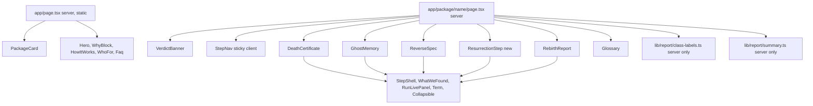

# Design Document: Revenant UX Redesign

## Overview

The deployed site works, but a first-time visitor cannot tell what Revenant is for or what each part of a package page means. The home page gives one sentence of explanation. The package page is one long scroll of four sections, ends with the verdict, and shows internal identifiers (class IDs, Evidence IDs, ISO timestamps). Stage 4 (Resurrection) is missing, so the flow jumps from step 3 to step 5.

This redesign changes presentation only. It keeps the Halloween theme, the evidence-not-proof stance, the existing API routes and the existing data shapes. The home page gains a plain-language explanation and a "start here" path. The package page gains a verdict banner at the top, a sticky five-step navigation, a "What this step does / What we found" pair at the start of each step, plain labels for technical values, and clear explanations for every "Run live" button.

The code language is TypeScript (Next.js App Router, React, Tailwind), matching the repository.

## Problems and Goals

| Observed problem | Design response |
|---|---|
| Home explains the product in one sentence; no problem, audience, or flow | Hero with problem and answer, "Why this exists", "How it works" strip, "Who this is for" |
| No "start here" | Primary CTA "See a full example: lodash.set"; the lodash.set card is flagged "Start here" |
| Cards link to stage jargon | One link per card ("Open lodash.set"); status chips replace stage links |
| Verdict buried at the bottom | Verdict banner directly under the package title |
| Four sections, no explanation | Each step opens with "What this step does" and "What we found" |
| Stage 4 missing | Step 4 "Resurrection" shown in the nav and as a section, labelled "happens in Kiro" |
| Unexplained "Run live" buttons | Each button gets a panel: what happens, how long, what it does not change |
| Raw IDs and ISO timestamps | Plain labels and human dates; raw values on demand |
| Evidence table dumps hundreds of rows | Collapsed by default, with a summary; behavior groups shown first |
| Packages without a rebuild look broken | Explicit "Not rebuilt yet" step 4 and step 5 explanations |

Non-goals: new API routes, new data files, changes to Ghost Memory, Reverse Spec or diff behavior, running arbitrary packages, new languages.

## Architecture

The page stays server-rendered with client islands. The package page remains a server component that loads data and passes plain props to client components. Two small pure helpers are added for server-side use. Client components keep their local structural types and do not import from `lib/` or `sandbox/`.



### Information architecture

Home: Hero, Why this exists, How it works (five steps), The Graveyard (four cards), Who this is for, Questions.

Package page, top to bottom: breadcrumb, title and one-line description, Verdict banner, sticky Stepper, Steps 1 to 5, Glossary.

### Layout decision: long single page, not tabs

Keep one scrollable page with a sticky stepper that jumps to anchors. Reasons: existing deep links (`#autopsy`, `#ghost-memory`, `#reverse-spec`, `#rebirth-report`) keep working; the page prints and searches naturally; no hidden state for screen readers. Tabs are listed as a decision for the user below.

## Components and Interfaces

### New and changed components

| Component | Status | Purpose |
|---|---|---|
| `StepShell` | new, shared | Wraps a step: kicker "Step N of 5", heading, `id`, `scroll-mt`, optional `whatItDoes`, `whatWeFound` slots |
| `RunLivePanel` | new, shared | Describes a live action before it is run: what happens, duration, what it does not change; hosts the button and the status area |
| `Term` | new, client | Glossary term with a keyboard-reachable, tap-friendly explanation |
| `Collapsible` | new, thin `details` wrapper | Consistent summary line with counts |
| `VerdictBanner` | new, server | Title sentence, four fact tiles, three actions, honesty line |
| `StepNav` | new, client | Sticky five-step navigation with scroll tracking |
| `ResurrectionStep` | new, server | Step 4: explains Kiro, shows the rebuild exists, links to GitHub |
| `PackageCard` | new, server | Card with status chips and a one-line verdict |
| `Hero`, `WhyBlock`, `HowItWorks`, `WhoFor`, `Faq`, `Glossary` | new, server | Home and package page copy blocks |
| `DeathCertificate` | changed | Plain labels, human dates, snapshot/live badge in words, `RunLivePanel` |
| `GhostMemory` | changed | Behavior groups first; evidence table collapsed; coverage explained |
| `EvidenceTable` | changed | Plain columns; technical ID behind a toggle; unchanged paging |
| `ReverseSpec` | changed | Requirements list with citation counts; files collapsed; budget copy |
| `RebirthReport` | changed | Score bar plus text, deliberate-difference card, no-rebuild explanation |
| `SeanceProgress` | unchanged | Reused by both live runs |

### Interfaces

```ts
// components/steps.ts (client-safe, no lib/ imports)
export interface RunLiveCopy {
  action: string;          // "Check again", "Record again", "Write again", "Compare again"
  what: string;            // what happens
  takes: string;           // "a few seconds", "up to 30 seconds"
  changesNothing: string;  // what stays untouched
  limit?: string;          // Reverse Spec budget line
}

export type StepState = "done" | "in-kiro" | "not-started" | "unavailable";

export interface StepNavItem {
  n: 1 | 2 | 3 | 4 | 5;
  slug: "autopsy" | "ghost-memory" | "reverse-spec" | "resurrection" | "rebirth-report";
  label: string;
  state: StepState;
}

export interface VerdictFact {
  key: "last-release" | "vulnerabilities" | "rebuild" | "match" | "fix";
  label: string;
  value: string;
  detail: string;
  tone: "dead" | "warn" | "ok" | "neutral";
}
```

### Server-side helpers (small, justified)

Both are pure functions called from the server page, so client components keep no `lib/` imports. Their output is passed down as props.

```ts
// lib/report/class-labels.ts
export interface ClassFeature { feature: string; allowed: string[] }
export function describeClass(classId: string): { label: string; technicalId: string };
export function groupClassCounts(
  rows: { classId: string; count: number }[]
): { classId: string; label: string; count: number; polluting: boolean }[]; // sorted, largest first

// lib/report/summary.ts
export interface PackageSummary {
  headline: string;        // "lodash.set is dead, had a security problem, and has been rebuilt."
  facts: VerdictFactData[];
  rebuild: "rebuilt" | "not-rebuilt";
}
export function buildSummary(input: {
  cert: CertificateLike | null;
  recording: RecordingStatsLike | null;
  report: StoredReportLike | null;
  resurrected: boolean;
  now: Date;
}): PackageSummary;
```

Why helpers and not component code: the class labels are derived from `classId` strings that only the server side currently understands, and a plain pure function is easy to test with property tests. The summary builder keeps the numbers on the banner identical to the numbers in the steps, because both read the same loaded data.

Date formatting is a client-safe pure function in `components/format-date.ts` with no imports from `lib/`.

```ts
export function humanDate(iso: string, now: Date): { text: string; relative: string };
// humanDate("2016-08-13T17:44:16.595Z", new Date("2026-11-18")) -> { text: "Aug 13, 2016", relative: "about 10 years ago" }
```

## Page Designs

The mock in `mock/` shows these layouts with real data. Summary of each.

### Home

1. **Hero.** H1: "Replace a dead npm package, and see how closely the replacement behaves like the original." Lead paragraph names the problem (unmaintained packages, no security fixes) and the answer (record behavior, build from the record, compare). Primary CTA "See a full example: lodash.set →", secondary "Browse the four packages". Small line: "No login. Revenant reports evidence, not proof."
2. **Why this exists.** Two panels: "Without Revenant" (keep, rewrite by hand, ask an AI) and "With Revenant" (record, spec, compare).
3. **How it works.** Five numbered cards in plain language. Each says where it happens: "In your browser" or "In Kiro" (step 4).
4. **The Graveyard.** Four cards. Each card: name and version, one-line description, status chips, a one-sentence verdict, one link. Chips: `Dead since Aug 2016`, `Deprecated on npm`, `Repository archived`, `1 known vulnerability`, `Rebuilt` or `Not rebuilt yet`. The rebuilt cards show the match: "942 / 942 scored inputs".
5. **Who this is for.** The target user from the brief, and what they can do here.
6. **Questions.** Four collapsed items: is a high score safe, can I try my own package, do I need an account, what does "dead" mean.

The card data comes from the files the loader and package page already read (`manifest.json`, `autopsy.json`, `diff-run.json`). The home page remains `force-static`; it uses fixed phrases like "Dead since Aug 2016" so nothing goes stale between builds. Relative phrases ("about 10 years ago") appear only on the package page, which is `force-dynamic`.

### Package page

1. **Header.** Package name, version, one-line description of what the package does.
2. **Verdict banner.** Headline sentence plus four tiles: Last release, Known vulnerabilities, Behavior match (or "No score"), Vulnerability in rebuild (or "Rebuild: Not yet"). Actions: "Read the Rebirth Report", "Download Kiro spec bundle", "View the rebuild on GitHub". A one-line honesty note: evidence, not proof, with the branch coverage figure.
3. **Sticky stepper.** Five pills with a state marker (done, in Kiro, not started, unavailable). The current step carries `aria-current="step"`. On narrow screens the pills scroll horizontally.
4. **Steps 1 to 5.** Each step has the same shape:
   - kicker "Step N of 5 · Name" and a plain heading
   - two boxes: "What this step does" and "What we found"
   - the detail panel
   - a `RunLivePanel`
5. **Glossary.** Five terms: Ghost Memory, Evidence, Behavior group, Intentional difference, Prototype pollution. The same terms also appear as inline `Term` popovers on first use in each step.

#### Step detail

| Step | Detail panel | Plain-language changes |
|---|---|---|
| 1 Autopsy | Facts list | "Status: Unmaintained", "Last release: Aug 13, 2016 (about 10 years ago)", vulnerability with the advisory ID in small text |
| 2 Ghost Memory | Coverage, behavior groups, collapsed evidence table | "Dotted path (a.b) on a plain object: returned a value, 276 inputs"; raw class ID behind "Show technical IDs"; top 8 groups shown, the rest in a collapsible |
| 3 Reverse Spec | Requirement list with citation counts, collapsed spec files, download button | "Cites 4 groups · 96 inputs" instead of ID lists |
| 4 Resurrection | Callout and link | Explains Kiro, links to `resurrected/<pkg>` on GitHub, shows `npm run resurrect -- <pkg>` |
| 5 Rebirth Report | Score text and bar, deliberate difference card, vulnerability removed, mismatches, original test suite | Score bar has a text legend, so colour is never the only signal |

#### Run live panels

| Step | Button | What happens | Takes | Does not change |
|---|---|---|---|---|
| 1 | Check again | Asks npm, OSV and GitHub for current facts | a few seconds | The stored snapshot |
| 2 | Record again | Runs the original in the sandbox on fresh inputs, with séance candles | up to 30 seconds (the server run limit); "partial" if the clock expires | The stored recording; coverage is not measured live |
| 3 | Write again | Live request to an AI model (Groq) | usually under a minute, to be measured | The stored spec; uses the daily budget of 5 per visitor and 50 in total |
| 5 | Compare again | Runs original and rebuild on the same fresh inputs | to be measured | The stored report |

Durations for steps 3 and 5 are placeholders until measured. The 30-second figure for step 2 comes from `LIVE_RUN_TIMEOUT_MS` in the ghost-memory route.

#### Packages without a rebuild (deep-extend, string)

- Banner: "string is dead, has a security problem, and has not been rebuilt yet." The match tile reads "No score" with "a score needs a rebuild to compare with".
- Stepper: step 4 "not started", step 5 "needs a rebuild".
- Step 4 callout: no rebuild exists yet; rebuilding is done by a person in Kiro; so far lodash.set and lodash.pick are done; how to start from the spec bundle.
- Step 5 callout: why there is no report (nothing to compare), what to do (see lodash.set, or build and run `npm run resurrect`). The Compare button is disabled and linked to the reason by `aria-describedby`.
- deep-extend has no known vulnerability, so its banner says so; it does not say "had a security problem".

### Copy rules

- Plain words first, internal names second. "Ghost Memory" stays as the step name, explained at first use.
- Numbers always come with their denominator and a source: "942 / 942 scored inputs matched".
- Dates: "Aug 13, 2016 (about 10 years ago)". Timestamps for stored data are dates only ("Nov 17, 2026"). The ISO value stays in the `datetime` attribute.
- Never use "proven", "guaranteed" or "identical". The phrase "evidence, not proof" is allowed. Prefer "matched", "agreed", "same result".
- Label the data source in words: "stored snapshot" or "live".
- Active voice, sentences under about 25 words, no unexplained abbreviations (CVE and GHSA appear only as small detail text).

## Data Models

No stored shape changes. The server page reads the same files as today and additionally passes derived props.

```ts
// Derived, not stored
interface PackageCardData {
  name: string;
  version: string;
  oneLiner: string;                 // see Open Questions: where this text lives
  chips: { text: string; tone: "dead" | "warn" | "ok" | "info" }[];
  verdict: string;
  resurrected: boolean;
}

interface BehaviorGroup {
  classId: string;                  // raw, shown on demand
  label: string;                    // plain language
  count: number;
  polluting: boolean;               // drives the red bar; the text still says what happened
}
```

Plain labels are derived from `classId` segments (`<path shape>|<target type>|<outcome>`) using the feature names from the manifest. Unknown segments fall back to the raw segment text, so a new package never breaks the page.

| classId segment | Label |
|---|---|
| `dot` | Dotted path (a.b) |
| `bracket-index` | Bracket path (a[0]) |
| `mixed` | Mixed path (a[0].b) |
| `empty` | Empty path |
| `proto-path` | Prototype-style path (`__proto__`) |
| `plain-object` / `array` / `primitive` / `null-or-undefined` | a plain object / an array / a number or string / null or undefined |
| `returned` / `threw:TypeError` / `threw:other` | returned a value / threw a TypeError / threw another error |
| `prototype-pollution` | changed Object.prototype (label reads "Prototype-polluting path on a plain object") |
| `unclassified` | Inputs that fit no group |

For `string` and `deep-extend` the segments differ (`ascii`, `empty`, `nested`, `two-plain`, and so on). The helper holds a small lookup per feature name and falls back to the segment text.

## Algorithmic Pseudocode

### describeClass

```ts
function describeClass(classId: string): { label: string; technicalId: string } {
  const tail = classId.split(":class:")[1] ?? classId;
  if (tail === "unclassified") return { label: "Inputs that fit no group", technicalId: classId };
  const parts = tail.split("|");                      // path | target | outcome
  const label = composeLabel(parts.map(lookupSegment)); // lookup falls back to the raw segment
  return { label, technicalId: classId };
}
```

**Preconditions:** `classId` is a string.
**Postconditions:** `label` is non-empty; `technicalId === classId`; never throws.
**Loop invariants:** N/A.

### buildSummary

```ts
function buildSummary(input): PackageSummary {
  const dead = input.cert?.inactive ?? "unknown";
  const vulnCount = input.cert?.vulnerabilities.length ?? "unknown";
  const rebuilt = input.resurrected && input.report !== null;
  const headline = composeHeadline(name, dead, vulnCount, rebuilt);
  const facts = [lastRelease, vulnerabilities, rebuilt ? match : noScore, rebuilt ? fix : rebuildStatus];
  return { headline, facts, rebuild: rebuilt ? "rebuilt" : "not-rebuilt" };
}
```

**Preconditions:** inputs may be null (missing stored files).
**Postconditions:** always returns four facts; a missing input produces the value "unknown" with the reason, never a blank tile; the match value equals `report.scoreText`; the headline never claims "rebuilt" unless a report and a rebuild exist.
**Loop invariants:** N/A.

## Example Usage

```tsx
// app/package/[name]/page.tsx (server)
const summary = buildSummary({ cert, recording, report, resurrected, now: new Date() });
const groups = groupClassCounts(recording?.rows ?? []);
return (
  <main id="main">
    <VerdictBanner summary={summary} name={manifest.name} />
    <StepNav items={stepStates(summary, resurrected)} />
    <DeathCertificate name={name} initial={cert} />
    <GhostMemory name={name} recording={recording} coverage={coverage} groups={groups} />
    <ReverseSpec name={name} bundle={bundle} />
    <ResurrectionStep name={name} resurrected={resurrected} />
    <RebirthReport name={name} report={report} resurrected={resurrected} />
    <Glossary />
  </main>
);
```

## States

| Area | Loading | Empty | Error |
|---|---|---|---|
| Death Certificate | "Working… this can take a few seconds." with `aria-live` | "No stored snapshot for this package. Use Check again." | "Live check failed (HTTP 503). Showing the stored snapshot. Nothing was changed." |
| Ghost Memory | Séance candles with "Recording: 400 / 1,000 inputs" | "No stored recording. Use Record again." | "Live run failed: {message}. Showing the stored recording." |
| Reverse Spec | "Writing the spec…" | "No stored spec. Download is unavailable." | Budget used: "No AI runs left today for you (5 per visitor, 50 in total). Showing the stored spec." Other errors keep the existing message plus "Nothing was changed." |
| Rebirth Report | Candles with "Differential run" | Not rebuilt: step 5 callout. Rebuilt but no stored report: "No stored report. Use Compare again." | "Live run failed: {message}. Showing the stored report." HTTP 409 maps to the not-rebuilt callout |

Every error message says what is shown instead and that nothing was changed. Messages are announced through the existing `aria-live="polite"` regions.

## Accessibility

- Contrast: no new colour pairs. The mock uses only pairs already in `contrastPairs`: accent text (pumpkin, ectoplasm, blood, wisp, candle) on `crypt` or `tomb`; `bone` and `ash` on `crypt`, `tomb` and `slab`; `crypt` on filled accent buttons and chips. Accent text is never placed on `slab`, because those pairs are not tested. If implementation needs another pair, add it to `contrastPairs` first.
- Colour is never the only signal: status chips carry words, the score bar has a text legend and an `aria-label`, vulnerable behavior groups say "changed Object.prototype".
- Motion: candles, flicker and drift stay inside `prefers-reduced-motion: no-preference`. Smooth scrolling for the stepper is inside the same media query.
- Landmarks and headings: one `h1`; steps are `section`s labelled by their `h2`; the stepper is a `nav` with `aria-label` and `aria-current="step"`.
- Glossary terms: a real `button` that toggles a short, non-interactive description. Opens on hover, focus and click or tap, and closes on Escape. The description is linked with `aria-describedby`.
- Collapsibles use native `details`/`summary`, which are keyboard operable.
- Touch targets: buttons are at least 40 px high; stepper pills at least 32 px.
- Focus: existing focus ring (wisp, 2 px) is kept; the skip link stays.
- Mobile: single column; verdict tiles stack; the stepper scrolls horizontally; tables scroll inside their container; long IDs wrap.

## Error Handling

- Missing data never blanks a tile. `buildSummary` returns "unknown" with a reason, matching the existing `Unknown` field treatment on the certificate.
- An unknown `classId` segment falls back to its raw text.
- A package with no manifest still returns 404 through `notFound()` as today.

## What Stays Unchanged

- Halloween theme: tombstone cards, death certificate, séance candles, rebirth report, display font for headings.
- Colour tokens, Cinzel (display) and Inter (body) fonts, `tailwind.config.ts`.
- API routes and response shapes: `/api/autopsy`, `/api/ghost-memory`, `/api/reverse-spec`, `/api/diff`, `/api/spec-bundle`.
- Stored data files and the manifest schema.
- The honest-language rule and the "evidence, not proof" stance; the score always shows its denominator.
- Client components keep local structural types and import nothing from `lib/` or `sandbox/`.
- Existing anchors `#autopsy`, `#ghost-memory`, `#reverse-spec`, `#rebirth-report` (a new `#resurrection` is added). The step sections keep these `id`s so old links still work; the stepper links use the same ids.
- Stage labels remain the names of the steps. Only their explanation changes.

## Correctness Properties

*A property is a characteristic or behavior that should hold true across all valid executions of a system. Properties are the bridge between human-readable specifications and machine-verifiable guarantees. Only the pure helpers are suited to property tests; layout and copy are checked with example tests and the existing string scan.*

### Property 1: Class labels are total and reversible

For any `classId` string, `describeClass` returns a non-empty label, returns the original `classId` as `technicalId`, and does not throw.

### Property 2: Group counts are conserved

For any list of rows with non-negative counts, the sum of counts returned by `groupClassCounts` equals the sum of the input counts, and the output is sorted by count descending.

### Property 3: Human dates are consistent with their input

For any valid ISO timestamp and any `now` not before it, `humanDate` returns text containing the correct four-digit year of the timestamp, and a relative phrase whose year figure differs from the true whole-year gap by at most one.

### Property 4: The summary banner agrees with its sources

For any combination of present or missing certificate, recording and report, `buildSummary` returns four facts, never an empty value, and the match fact equals the report's `scoreText` when a report exists.

### Property 5: Banner never overstates

For any input where no rebuild or no report exists, the summary headline does not contain "rebuilt" as a completed state and the match fact reads "No score".

### Property 6: Forbidden words never appear

For any string produced by the new helpers and any string literal in the new components and pages, `findViolations` returns an empty list. The existing `ui-strings.test.ts` already scans `components/` and `app/`; the helper outputs need a matching test because `lib/` is not scanned.

### Property 7: Step states match the data

For any package, the stepper marks step 5 as unavailable if and only if no rebuild exists, and marks step 4 as "in Kiro, done" if and only if a rebuild exists.

Mapping of these properties to numbered requirements happens after `requirements.md` is written.

## Testing Strategy

### Unit tests

- `describeClass` against the real class IDs from all four packages (snapshot of labels).
- `humanDate` at boundaries (same day, under a year, exactly ten years).
- `buildSummary` for the four real packages: lodash.set, lodash.pick, string, deep-extend.
- Component tests in `tests/components` for: banner text for rebuilt and not-rebuilt packages, collapsed evidence table by default, Run live panel text present for all four buttons, disabled Compare button with a description for a not-rebuilt package.

### Property-based tests

Library: `fast-check` (already used in the repository). At least 100 runs per property. Tag format: **Feature: revenant-ux, Property N: title**.

### Existing checks that must keep passing

`tests/contrast.property.test.ts`, `lib/report/ui-strings.test.ts`, `tests/static-import-checks.test.ts`, `tests/components/*`.

### Manual checks

Keyboard-only walk through both pages; screen reader pass on the stepper and glossary; reduced-motion on; 390 px and 1200 px widths.

## Performance Considerations

No new network calls. The home page stays static. The package page reads the same files, plus the helpers run once per request over at most a few thousand evidence rows. Rendering the evidence table stays paged at 50 rows, and it is not mounted until the collapsible is opened.

## Security Considerations

No new inputs and no new endpoints. Glossary and label text is static or derived from allowlisted stored data and rendered as text by React, not as HTML. External links use the repository URL only and open with the default same-tab behavior.

## Dependencies

Changed during implementation (2026-11-18), at the user's request for a richer motion and 3D layer. All pinned to exact versions published at least two weeks before install:

| Package | Version | Used for |
|---|---|---|
| `motion` | 14.9.0 | Scroll reveals, number tickers, step-nav highlight, score ring, bars |
| `three` | 0.186.1 | Home hero graveyard scene |
| `@react-three/fiber` | 9.8.2 | React renderer for the scene (peer range allows React 19.3) |
| `lucide-react` | 1.66.0 | Step and status icons |
| `@types/three` (dev) | 0.186.0 | Types |

The Magic UI / 21st.dev style pieces (blur-fade reveal, number ticker, spotlight card, border beam, shimmer button, animated pipeline) are written in `components/ui/` and `globals.css`, not installed: those sites are copy-paste registries, not npm packages.

Guard rails: the 3D scene loads client-only after hydration, pauses off screen, renders one still frame under reduced motion, and falls back to a static gradient without WebGL. Reveal content is visible in the server HTML; only blocks below the fold are hidden after hydration.

Helpers live in `app/_lib/` (`class-labels.ts`, `summary.ts`, `data.ts`, `package-copy.ts`) rather than `lib/report/` (open question 8): they are presentation code, and `app/` is covered by the forbidden-word scan. Properties 1 to 5 are tested in `tests/ux-helpers.property.test.ts`.

## Mock

Static HTML, no build. A shared `mock.css` and `mock.js` sit next to the pages (a small deviation from fully inline CSS, to avoid triplicating about 200 lines). Fonts load from Google Fonts with Georgia as the fallback. Colours are the real `colorTokens`.

| File | What it shows |
|---|---|
| [mock/index.html](mock/index.html) | Home page |
| [mock/package-lodash-set.html](mock/package-lodash-set.html) | Rebuilt package: banner, stepper, all five steps, glossary. Fake Run live: step 1 succeeds, step 2 and 5 show candles, step 3 shows the budget-used error |
| [mock/package-string.html](mock/package-string.html) | Not-rebuilt package: steps 4 and 5 explain why they are empty |
| [mock/mock.css](mock/mock.css), [mock/mock.js](mock/mock.js) | Shared styles and the fake interactions |

Open with `open .kiro/specs/revenant-ux/mock/index.html`. The lodash.pick and deep-extend cards are not built as pages; they would reuse the lodash.set layout and the string layout respectively. Download links and the GitHub link need the real site or network to work.

## Open Questions and Decisions for the User

1. **Tone of copy.** The mock is plain and neutral. Should the Halloween voice show more in the copy (for example "Death Certificate", "séance") or stay in the visuals only?
2. **Long page or tabs.** The design keeps one long page with a sticky stepper. Tabs would shorten the page but break existing anchors and hide content.
3. **Where per-package one-liners live.** The banner and cards say what each package does ("Sets a value deep inside an object"). The manifest has no such field. Options: (a) a constants map in `app/` (no data change, my recommendation), (b) a new optional manifest field (changes a schema and its validation).
4. **Run live durations.** Step 3 and step 5 durations are placeholders. Do you want me to measure them on the deployed site and put real figures in?
5. **Hero headline.** The mock headline is long and literal. Alternative shorter option: "Bring dead npm packages back, with evidence." Which do you prefer?
6. **"Dead" wording.** The mock says "Dead since Aug 2016" on chips. A softer option is "Unmaintained since Aug 2016". The page already says "Unmaintained" in the status row.
7. **Open-source claim.** The footer says "open source (MIT)", based on the repository `LICENSE`. Confirm this is wanted on the page.
8. **Server helpers.** Are you comfortable with the two small new files in `lib/report/` (`class-labels.ts`, `summary.ts`)? The alternative is to compute labels inside the server page file, which is harder to test.
9. **Home card for pages built later.** Should cards for rebuilt packages show the match number, as in the mock, or only "Rebuilt"? The number is stronger evidence, and it also shows up in the banner on the package page.
